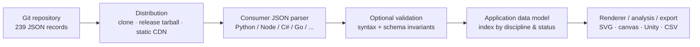
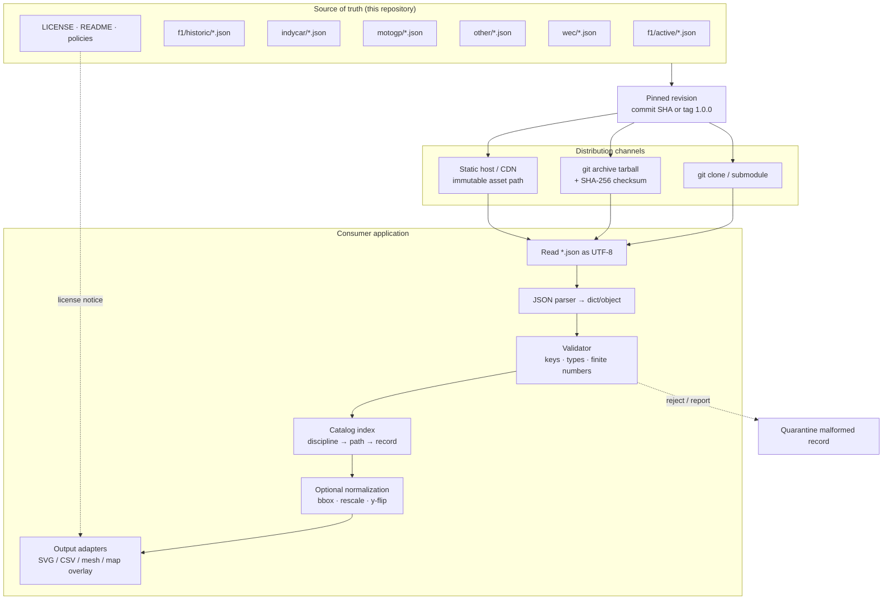
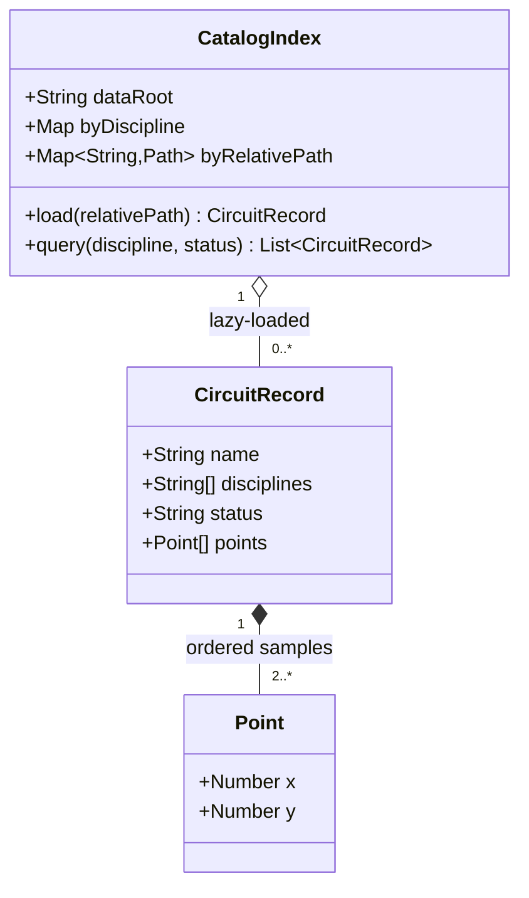

# Global Motorsport Circuits JSON

**A dependency-free, version-controlled catalog of 239 motorsport circuit layouts and metadata, distributed as plain JSON so developers can build track visualizations, racing apps, and dashboards without tracing layouts by hand.**

[](https://github.com/GameDev-Toolkit/global-motorsport-circuits-json/releases)
[](LICENSE)
[](https://www.json.org/)
[](#features)
[](#features)
[](#tech-stack-architecture)
[](#testing)
[](CONTRIBUTING.md)
[](CODE_OF_CONDUCT.md)

> [!IMPORTANT]
> **Scope clarification.** Despite the "logging library" framing of the documentation brief, this repository is **not** an executable logging library, SDK, or hosted API. It is a **static, data-only catalog**: 239 standalone JSON files containing circuit names, discipline tags, status labels, and ordered `x`/`y` path samples. There is no logger class, no `debug()`/`info()`/`warn()`/`error()` API, no handlers, sinks, appenders, log levels, or async pipeline. This README applies the requested documentation structure to the **actual** project, so logging-native concepts are mapped to their real equivalents here: the "logging pipeline" is the **data consumption pipeline**, "custom formatters" are **consumer-side serialization/export routines**, and "configuration" is the **record schema plus consumer-side settings**. If you were looking for documentation for a logging framework, point us at the correct repository and we will write that README instead.

> [!WARNING]
> The coordinate values carry **no declared coordinate reference system (CRS), datum, unit, origin semantics, scale, or transform**. They are local planar samples. Do **not** interpret them as latitude/longitude, and do **not** assume metres, kilometres, or pixels without an independently verified calibration source. See [Edge cases and gotchas](#edge-cases) before publishing derived geometry.

> [!NOTE]
> **Badge policy.** Build-status, npm/pypi-version, and test-coverage badges are deliberately **omitted**: this repository ships no build system, no package manifest, no unit-test runner, and no coverage instrumentation, so such badges would be decorative fiction. The badges above are either dynamic GitHub metadata (release) or verifiable snapshot facts (record count, sample count, zero dependencies, validation result) measured at commit `0c94173` / release `1.0.0`. Counts will drift as the dataset grows — always recompute them from your checkout.

> [!TIP]
> In a hurry? `git clone https://github.com/GameDev-Toolkit/global-motorsport-circuits-json.git`, then read any `*.json` file with your language's standard JSON parser. There is **no install, build, or compile step**.

---

## Table of Contents

- [Features](#features)
- [Tech Stack & Architecture](#tech-stack-architecture)
  - [Core Technologies](#core-technologies)
  - [Project Structure](#project-structure)
  - [Key Design Decisions](#key-design-decisions)
  - [Deep Dives: Pipeline and Data Model](#deep-dives)
- [Getting Started](#getting-started)
  - [Prerequisites](#prerequisites)
  - [Installation](#installation)
  - [Alternative installation & troubleshooting](#alternative-installation)
- [Testing](#testing)
  - [Validation commands](#testing)
  - [Validator script, schema checks, smoke tests, CI](#testing-deep-dives)
- [Deployment](#deployment)
- [Usage](#usage)
  - [Basic Usage](#basic-usage)
  - [Advanced Usage](#advanced-usage)
  - [Custom Formatters](#custom-formatters)
  - [Edge cases and gotchas](#edge-cases)
- [Configuration](#configuration)
  - [Runtime configuration surface](#configuration-surface)
  - [Record field reference & JSON Schema](#record-schema)
  - [Illustrative consumer-side settings](#consumer-settings)
- [License](#license)
- [Contacts & Community Support](#support-the-project)

---

## Features

- **239 standalone circuit records**, one JSON document per circuit, each independently loadable without reading the rest of the catalog.
- **411,783 ordered 2D coordinate samples** across the collection (83 to 5,148 points per record), suitable for polyline rendering, spline fitting, length heuristics, and shape analysis.
- **Six data directories** organized by motorsport family: `f1/active/`, `f1/historic/`, `indycar/`, `motogp/`, `other/`, and `wec/`.
- **Active/historic classification** both in the folder layout (for Formula 1) and in every record's `status` field (`active` or `historic`).
- **Cross-series tagging** via an open-ended `disciplines` array: 15 distinct tags and 349 tag occurrences, so a single circuit can be discovered through multiple championships.
- **Uniform, machine-validatable schema**: exactly four top-level keys (`name`, `disciplines`, `status`, `points`) and exactly two keys per point (`x`, `y`) in all 239 files — no per-file special cases, no optional-field guessing.
- **Zero runtime dependencies**: no `package.json`, `pyproject.toml`, `requirements.txt`, database, service, or network call is required. Any environment with a JSON parser (Python, Node.js, C#/Unity, Go, Rust, Java, browsers, embedded runtimes) can consume the data.
- **Language- and platform-neutral UTF-8 text**: human-readable, diff-friendly, and reviewable in a normal pull request. 37 files contain non-ASCII circuit names, so the catalog exercises real Unicode handling.
- **Git-native collaboration**: every data change is a normal commit with reviewable diffs; [`CONTRIBUTING.md`](CONTRIBUTING.md), [`CODE_OF_CONDUCT.md`](CODE_OF_CONDUCT.md), and [`SECURITY.md`](SECURITY.md) define the contribution, conduct, and disclosure workflows.
- **Permissive Apache-2.0 licensing** with an explicit patent grant, allowing commercial, closed-source, and redistribution use subject to notice/attribution conditions.
- **Releasable as a static asset**: ~12.8 MiB of JSON in total, easy to vendor into an application bundle, ship through a CDN, or package as a tarball pinned to a commit SHA.
- **Deterministic starting point**: every one of the 239 records begins at `{ "x": 0.0, "y": 0.0 }`, which simplifies normalization and diffing between layouts.
- **No telemetry, timing, or live data**: the catalog is a geometry/metadata snapshot, making it stable for offline tools, reproducible builds, and deterministic tests.

### Snapshot statistics

<details>
<summary>Dataset counts measured at commit <code>0c94173</code> (release <code>1.0.0</code>)</summary>

| Directory | Records | Share |
| --- | ---: | ---: |
| `f1/active/` | 23 | 9.6% |
| `f1/historic/` | 35 | 14.6% |
| `indycar/` | 47 | 19.7% |
| `motogp/` | 14 | 5.9% |
| `other/` | 108 | 45.2% |
| `wec/` | 12 | 5.0% |
| **Total** | **239** | **100%** |

| Metric | Value |
| --- | ---: |
| Total JSON payload | 13,399,710 bytes (~12.8 MiB) |
| Total coordinate points | 411,783 |
| Smallest record | 83 points — `f1/historic/circuito_do_estoril.json` |
| Largest record | 5,148 points — `other/mount_panorama_circuit.json` |
| Mean / median points per record | ~1,722.9 / 1,816 |
| Records starting at `(0.0, 0.0)` | 239 / 239 |
| Explicitly closed loops (first point == last point) | 51 / 239 |
| Distinct display names | 239 / 239 |
| Status: `active` / `historic` | 115 / 124 |
| Files containing non-ASCII UTF-8 | 37 |
| Tracked files in the repository | 244 (239 JSON + 5 Markdown/license files) |

Reproduce the headline numbers yourself:

```bash
find f1 indycar motogp other wec -name '*.json' | wc -l
python3 -c 'import json,pathlib; r=("f1","indycar","motogp","other","wec"); print(sum(len(json.loads(p.read_text(encoding="utf-8"))["points"]) for x in r for p in pathlib.Path(x).rglob("*.json")))'
```

</details>

<details>
<summary>Observed discipline tags, status distribution, and taxonomy caveats</summary>

Discipline counts are **tag occurrences**, not unique files. They sum to 349 — more than the 239 records — because records may carry multiple tags. The vocabulary is **extensible**, not a closed enum; new tags may appear in future commits.

| Discipline tag | Occurrences | | Discipline tag | Occurrences |
| --- | ---: | | --- | ---: |
| `dtm` | 9 | | `nascar` | 11 |
| `elms` | 19 | | `other` | 10 |
| `f1` | 58 | | `stock_car` | 15 |
| `formula_e` | 21 | | `super_gt` | 4 |
| `gt` | 17 | | `supercars` | 27 |
| `imsa` | 17 | | `touring_car` | 18 |
| `indycar` | 67 | | `wec` | 16 |
| `motogp` | 40 | | **Total** | **349** |

- `status` is a **catalog label**, not a live event feed. `active` does not guarantee a current race on the calendar, and `historic` does not imply the physical facility no longer exists.
- **Directory names are organizational groupings, not a complete taxonomy.** For example, 10 of the 12 files in `wec/` do not carry the `wec` tag (they are tagged `imsa`, `indycar`, `elms`, etc.). Always filter on `disciplines`, and treat the path as a hint.
- Tag strings are lowercase snake_case in the current snapshot, with no duplicates inside a record — but do not rely on that as a schema guarantee; the [JSON Schema](#configuration) is the contract to validate against.

</details>

<details>
<summary>Non-goals: what this repository deliberately does not provide</summary>

| Not included | Consequence for consumers |
| --- | --- |
| Logging/observability API of any kind | No handlers, formatters, sinks, levels, or runtime to configure. |
| Published package (`pip`, `npm`, NuGet, crates.io) | Vendor the JSON files, a Git submodule, or a release tarball instead of adding a dependency. |
| Generated index, manifest, or stable `id` field | Build your own index; do not treat file paths or display names as permanent keys. |
| CRS, unit, scale, transform, or georeferencing | Geographic mapping requires an external calibration source you must supply. |
| Start/finish line, layout version, pit lane, elevation, turn metadata | Only centerline-ish ordered samples and basic metadata are available. |
| Race results, lap times, telemetry, event calendars, source citations | Data provenance and measurement accuracy are not documented in the files. |
| Hosted API, database, server, Docker image, CI workflow | Reading files from disk or a static host is the entire integration surface. |

</details>

---

<a id="tech-stack-architecture"></a>
## Tech Stack & Architecture

### Core Technologies

| Layer | Technology | Notes |
| --- | --- | --- |
| Data serialization | **JSON** (RFC 8259), UTF-8, 2-space-indented | One document per circuit; point objects serialized one per line for readable diffs. |
| Version control | **Git** / GitHub | Default branch `main`; release tag `1.0.0`; no generated artifacts. |
| Documentation | **GitHub Flavored Markdown** | `README.md`, `CONTRIBUTING.md`, `CODE_OF_CONDUCT.md`, `SECURITY.md`. |
| Validation (optional, consumer-side) | **Python 3.8+ standard library** (`json`, `pathlib`, `math`) | Also demonstrated with Node.js 18+ and, optionally, `jq` / `jsonschema`. |
| Schema definition | **JSON Schema draft 2020-12** | Documented in [Configuration](#configuration) for downstream validation; no standalone schema file is shipped yet. |
| Rendering / analysis | **Any** graphics, GIS, plotting, or game engine | The data carries geometry only; all rendering is implemented by the consumer. |
| Runtime/build dependencies | **None** | No package manager manifest, compiler, linker, database, or service exists in this repository. |

The only hard requirement on a consumer is a **JSON parser**. Everything else — validation, indexing, coordinate transforms, path smoothing, SVG/canvas/Unity rendering — is application code that you own.

### Project Structure

The repository is a flat, two-level taxonomy: a family directory (plus an `active`/`historic` split for Formula 1) containing slug-named JSON files. There is no source tree, no `src/`, no `tests/`, no `dist/`, and no `.github/workflows/` in the current snapshot.

<details>
<summary>Repository tree (representative files, with directory counts)</summary>

```text
.
├── f1/                                  # Formula 1 (58 records)
│   ├── active/                          #   23 JSON files
│   │   ├── albert_park_circuit.json
│   │   ├── circuit_de_monaco.json
│   │   ├── silverstone_circuit.json
│   │   └── ... (20 more)
│   └── historic/                        #   35 JSON files
│       ├── adelaide_street_circuit.json
│       ├── nurburgring.json
│       └── ... (33 more)
├── indycar/                             #  47 JSON files
│   ├── indianapolis_motor_speedway.json  # (also present as an F1 historic record)
│   ├── st_petersburg_street_circuit.json
│   └── ... (45 more)
├── motogp/                              #  14 JSON files
│   ├── tt_circuit_assen.json
│   ├── sachsenring.json
│   └── ... (12 more)
├── other/                               # 108 JSON files — largest catch-all group
│   ├── mount_panorama_circuit.json
│   ├── goodwood_circuit.json
│   └── ... (106 more)
├── wec/                                 #  12 JSON files
│   ├── circuit_de_la_sarthe.json
│   ├── sebring_international_raceway.json
│   └── ... (10 more)
├── CODE_OF_CONDUCT.md                   # Contributor Covenant 2.1-inspired policy
├── CONTRIBUTING.md                      # Fork → branch → PR workflow
├── LICENSE                              # Apache License 2.0 (full text)
├── README.md                            # This document
└── SECURITY.md                          # Private vulnerability disclosure policy
```

Naming conventions observed in the snapshot:

- File names are **lowercase snake_case slugs** ending in `.json`; they are human-readable but are **not declared stable identifiers**.
- Display names inside records are unique in this snapshot but are **not** guaranteed unique across future revisions; a circuit can appear under more than one directory (for example Indianapolis has both an F1-historic and an IndyCar record).
- Paths are **relative to the repository root** and are case-sensitive on Linux/macOS filesystems.

</details>

### Key Design Decisions

1. **Data, not code.** The project's whole value is the geometry corpus. Keeping it as plain JSON files means zero installation friction, straightforward code review, and compatibility with every mainstream runtime. Any behavior (filtering, rendering, exporting) is intentionally pushed to consumers.
2. **One circuit per file.** Small, independently addressable documents parallelize well, minimize merge conflicts, and let applications lazy-load only the records they need instead of parsing a ~13 MiB megafile.
3. **A deliberately minimal, closed record shape.** Four required keys and no optional fields make validation trivial and keep the schema stable. Metadata that would require provenance (CRS, units, layout versions) is **omitted rather than guessed** — a documented absence is safer than a plausible-but-wrong value.
4. **Open-ended discipline vocabulary.** Tags are strings, not enum IDs, so new series can be added without a schema migration. Directories are a browsing aid; `disciplines` is the query surface.
5. **Ordered point arrays, not geographic features.** `points` is a sequence to be drawn in order. Rendering a polyline requires no topology, no polygon winding rules, and no GIS dependency.
6. **Git as the distribution and audit mechanism.** Commit SHAs and release tags provide reproducibility; pull requests provide review; `git archive` provides packaging. No registry or artifact store is needed.
7. **Permissive licensing with explicit patent grant.** Apache-2.0 was chosen over more restrictive copyleft licenses to make the dataset safe to embed in commercial games, dashboards, and closed-source products.



<a id="deep-dives"></a>
<details>
<summary>Deep dive: end-to-end data consumption pipeline (Mermaid)</summary>

The closest analogue to a "logging pipeline" in this project is the **static data supply chain** below. Note the explicit trust boundary: this repository ends at the JSON files; validation, interpretation, and rendering are entirely consumer responsibilities.



**Reading the diagram:** failure paths are explicit. A record that fails validation should be quarantined and reported rather than silently rendered — geometry errors are much harder to detect visually than a JSON parse error.

</details>

<details>
<summary>Deep dive: logical record model (Mermaid class diagram)</summary>



`CircuitRecord` and `CatalogIndex` are **conceptual** types for downstream code; the repository itself contains no classes and no implementation of `CatalogIndex` — a reference implementation is provided in [Advanced Usage](#advanced-usage).

</details>

<details>
<summary>Deep dive: coordinate model, invariants, and known limitations</summary>

**Observed invariants (validated across all 239 files):**

- Every record's first point is exactly `{ "x": 0.0, "y": 0.0 }`.
- Every point has exactly the keys `x` and `y`; both are IEEE-754 floating-point numbers.
- All coordinate values are finite; no `NaN`, `Infinity`, booleans, strings, or `null` coordinates exist.
- No booleans masquerade as numbers, no missing keys, no extra keys, no empty `disciplines` arrays, and no empty `name` strings.
- Across the corpus, `x` ranges from about `-2093.55` to `2705.13` and `y` from about `-4172.5` to `1811.73`. These are **observed extrema**, not declared bounds — never hard-code them as validation limits.

**Known limitations:**

- **No CRS/units.** Values are local planar coordinates. They are **not** WGS84 latitude/longitude; do not feed them directly into a web map.
- **Varying point density.** 83 → 5,148 points per circuit. Chord-length sums are **not** a reliable proxy for real circuit length; resample deliberately for any quantitative analysis.
- **Mixed loop closure.** Only 51 records repeat the first point at the end. Decide explicitly whether your renderer should append the first point to close the outline, otherwise you may draw a visible gap.
- **Orientation and handedness are unspecified.** Screen-space `y` typically grows downward while Cartesian `y` grows upward; you may need a `y` flip. Axis scales may not be equal — verify before assuming uniform aspect ratio.
- **No start/finish marker.** The first point is a sampling origin, not necessarily the start/finish line.
- **No provenance or accuracy claims.** Treat the geometry as illustrative until you validate it against an authoritative source for your use case.

</details>

---

## Getting Started

### Prerequisites

| Requirement | Version | Required? | Purpose |
| --- | --- | :---: | --- |
| Git | 2.25+ recommended | **Yes** (to clone) | Clone, pin, sparse-checkout, or `git archive` the data. |
| A JSON parser | Any | **Yes** (to consume) | Built into virtually every language runtime. |
| Python | 3.8+ | No | Used by the validation script and Python examples below (standard library only). |
| Node.js | 18+ | No | Used by the Node.js/ESM examples and cross-runtime smoke test. |
| `jq` | 1.6+ | No | Optional command-line JSON inspection and linting. |
| Docker / Docker Compose | Current stable | No | Only if you choose the optional static-hosting container in [Deployment](#deployment). |
| Network access | — | No (after checkout) | Data is fully offline-capable; no API keys, tokens, or `.env` secrets exist. |

> [!TIP]
> There is **no package manager step**. If a tutorial tells you to run `npm install` or `pip install` for this repository, it is describing a *consumer-side* dependency (for example `jsonschema` for schema validation), not a project requirement.

### Installation

**1. Clone the repository and enter it:**

```bash
git clone https://github.com/GameDev-Toolkit/global-motorsport-circuits-json.git
cd global-motorsport-circuits-json
```

**2. (Recommended for production) Pin a known-good revision** instead of tracking the moving `main` branch:

```bash
# Replace with the SHA or tag you have validated for your application.
git checkout --detach 1.0.0
git rev-parse HEAD   # record this SHA in your build metadata
```

**3. Verify the checkout** — confirm the record count and parse one file:

```bash
find f1 indycar motogp other wec -name '*.json' | wc -l   # expected: 239
python3 -m json.tool f1/active/albert_park_circuit.json > /dev/null && echo "JSON OK"
```

**4. Read a record** using only the Python standard library:

```bash
python3 -c 'import json, pathlib; p = pathlib.Path("f1/active/albert_park_circuit.json"); d = json.loads(p.read_text(encoding="utf-8")); print(d["name"], len(d["points"]), d["disciplines"], d["status"])'
```

Expected output:

```text
Albert Park Circuit 378 ['f1'] active
```

That is the entire "installation". From here, jump to [Usage](#usage) for real code, or [Testing](#testing) to validate the full corpus before shipping it.

<a id="alternative-installation"></a>
<details>
<summary>Alternative installation and access methods (including "building from source")</summary>

**A. Release tarball (no Git history):**

```bash
# Via the GitHub CLI (authenticated):
gh release download 1.0.0 --archive=tar.gz --dir ./dist

# Or via codeload (no authentication required):
curl -L --fail -o circuits-1.0.0.tar.gz \
  https://codeload.github.com/GameDev-Toolkit/global-motorsport-circuits-json/tar.gz/refs/tags/1.0.0
tar -tzf circuits-1.0.0.tar.gz | head
```

**B. Sparse checkout (only the series you need):**

```bash
git clone --filter=blob:none --sparse \
  https://github.com/GameDev-Toolkit/global-motorsport-circuits-json.git circuits
cd circuits
git sparse-checkout set f1/active motogp
git checkout 1.0.0
```

**C. Git submodule inside your own project:**

```bash
git submodule add -b main \
  https://github.com/GameDev-Toolkit/global-motorsport-circuits-json.git \
  vendor/circuits
git -C vendor/circuits checkout --detach 1.0.0
git commit -am "Pin motorsport circuits dataset to 1.0.0"
```

**D. Single raw file over HTTP:**

```bash
curl -L --fail -o albert_park_circuit.json \
  https://raw.githubusercontent.com/GameDev-Toolkit/global-motorsport-circuits-json/0c941730f3d3279da6a553f79c15e9ed62780b2c/f1/active/albert_park_circuit.json
```

Pin a **commit SHA** rather than `main` — the branch is mutable.

**E. "Building from source" — deriving a single-file bundle.** There is nothing to compile, but if your build system expects a single artifact, generate a deterministic consolidated index at build time (do **not** commit the generated file to this data repository):

```bash
python3 - <<'PY'
import json, hashlib
from pathlib import Path

roots = ("f1", "indycar", "motogp", "other", "wec")
out = {"$schema_version": "1.0", "source_revision": None, "circuits": []}

for root in roots:
    for path in sorted(Path(root).rglob("*.json")):
        record = json.loads(path.read_text(encoding="utf-8"))
        out["circuits"].append({
            "id": hashlib.sha1(path.as_posix().encode("utf-8")).hexdigest()[:12],
            "path": path.as_posix(),
            **record,
        })

payload = json.dumps(out, ensure_ascii=False, sort_keys=True, separators=(",", ":"))
out["source_revision"] = hashlib.sha256(payload.encode("utf-8")).hexdigest()
Path("circuits.bundle.json").write_text(
    json.dumps(out, ensure_ascii=False, indent=2) + "\n", encoding="utf-8"
)
print(f"Bundled {len(out['circuits'])} circuits")
PY
```

**F. Consumer-side package managers.** The dataset is not published to npm, PyPI, NuGet, or crates.io. If you need a dependency-style workflow, wrap the tarball or submodule in your own internal package; keep `LICENSE` inside it.

</details>

<details>
<summary>Troubleshooting installation and first-run issues</summary>

| Symptom | Cause | Fix |
| --- | --- | --- |
| `FileNotFoundError` / `ENOENT` | Process working directory is not the repository root, or a path was misspelled. | Use paths relative to the repo root, or resolve an absolute `DATA_ROOT`. Slugs are lowercase with underscores. |
| `JSONDecodeError` / `SyntaxError` | File edited with comments, trailing commas, or a BOM; or a partial download. | Use a standard JSON parser, save as UTF-8 without BOM, and re-download truncated files. Re-run `python3 -m json.tool <file>`. |
| `UnicodeDecodeError` | File read as ASCII/CP1252. 37 records contain non-ASCII names (e.g. `Autódromo ...`). | Always decode as UTF-8: `read_text(encoding="utf-8")` / `readFile(..., "utf8")`. |
| "No `package.json` / `pyproject.toml` found" | Expected, not an error. | The repo is data-only; there is nothing to install or build. |
| Record counts differ from this README | Snapshot drift, or a pinned older tag. | Recompute with `find ... -name '*.json' \| wc -l`; check `git rev-parse HEAD`. |
| It works on Windows but fails in CI (or vice versa) | Case-sensitive path differences and line endings. | Match exact lowercase slugs; the shipped files use LF endings — do not normalize them in data commits. |
| `jq: command not found` | `jq` is optional. | Install it with your OS package manager, or use `python3 -m json.tool` instead. |
| Large memory footprint when loading everything | Naively concatenating all 239 files (411,783 point objects). | Lazy-load per record, or generate the compact bundle from alternative method **E** above. |
| Corporate proxy blocks GitHub | Network policy. | Vendor the release tarball into your artifact store; no runtime network access is needed afterwards. |

</details>

---

## Testing

This repository contains **data, not executable library code**. Consequently there is no unit-test framework, no integration-test suite, no linter configuration, and no coverage tooling checked in — and no CI workflow on `main` (`gh api .../actions/workflows` reports `total_count: 0`). The equivalent quality gate for a data catalog is **syntax validation + schema invariant checking across every record**. The commands below are dependency-free unless explicitly marked optional.

| Check | Exact command | Status in repo |
| --- | --- | --- |
| Single-record JSON syntax | `python3 -m json.tool f1/active/albert_park_circuit.json > /dev/null` | Available (stdlib) |
| Full-corpus schema validation | `python3 - <<'PY' ... PY` (script below) | Available (stdlib) |
| Node.js syntax smoke test | `node -e 'JSON.parse(require("node:fs").readFileSync("f1/active/albert_park_circuit.json","utf8")); console.log("ok")'` | Available (stdlib) |
| JSON lint (optional) | `jq -e . f1/active/albert_park_circuit.json > /dev/null` | Requires `jq` |
| JSON Schema validation (optional) | `check-jsonschema --schemafile circuit.schema.json f1/active/*.json` | Requires `pip install check-jsonschema` and a saved schema file |
| Unit tests (`pytest`, `jest`, …) | Not applicable | No source modules or test runner exist |
| Integration tests (service/API) | Not applicable | No service; see the cross-runtime smoke test below for an equivalent |
| Lint / formatting | `git diff --check` (patch whitespace only) | No code linter configured |
| Test coverage | Not applicable | No instrumented code; coverage would be 0/N/A by construction |

**Run the fast checks first:**

```bash
# 1. Syntax-check one record with Python's built-in JSON module.
python3 -m json.tool f1/active/albert_park_circuit.json > /dev/null

# 2. Syntax-check with Node.js (no third-party modules).
node -e 'JSON.parse(require("node:fs").readFileSync("f1/active/albert_park_circuit.json","utf8")); console.log("ok")'

# 3. Check whitespace errors in an uncommitted patch.
git diff --check
```

**Run the full-corpus validator** (from the repository root):

```bash
python3 - <<'PY'
import json, math
from pathlib import Path

roots = ("f1", "indycar", "motogp", "other", "wec")
files = sorted(p for root in roots for p in Path(root).rglob("*.json"))
assert files, "No circuit JSON files found"

for path in files:
    record = json.loads(path.read_text(encoding="utf-8"))
    assert set(record) == {"name", "disciplines", "status", "points"}, path
    assert isinstance(record["name"], str) and record["name"].strip(), path
    assert isinstance(record["disciplines"], list) and record["disciplines"], path
    assert all(isinstance(t, str) and t.strip() for t in record["disciplines"]), path
    assert record["status"] in {"active", "historic"}, path
    assert isinstance(record["points"], list) and len(record["points"]) >= 2, path
    for index, point in enumerate(record["points"]):
        assert isinstance(point, dict) and set(point) == {"x", "y"}, (path, index)
        for axis in ("x", "y"):
            value = point[axis]
            assert (isinstance(value, (int, float)) and not isinstance(value, bool)
                    and math.isfinite(value)), (path, index, axis)

print(f"Validated {len(files)} JSON circuit records")
PY
```

Expected result on the current snapshot:

```text
Validated 239 JSON circuit records
```

<a id="testing-deep-dives"></a>
<details>
<summary>Full validation script (copy into <code>validate_circuits.py</code> for CI or local use)</summary>

The repository does not ship this script — it is a reference implementation you can vendor into your own pipeline. It checks syntax, the closed record shape, type correctness, finite numbers, duplicate tags, and useful geometric invariants, and it prints a machine-readable summary.

```python
#!/usr/bin/env python3
"""Validate every circuit record in global-motorsport-circuits-json.

Usage:  python3 validate_circuits.py [DATA_ROOT]
Exits:  0 = all records valid, 1 = at least one failure.
"""
from __future__ import annotations

import json
import math
import sys
from collections import Counter
from pathlib import Path

ROOTS = ("f1", "indycar", "motogp", "other", "wec")
REQUIRED_KEYS = {"name", "disciplines", "status", "points"}


def validate_record(path: Path) -> list[str]:
    """Return a list of human-readable problems for a single record."""
    errors: list[str] = []
    try:
        record = json.loads(path.read_text(encoding="utf-8"))
    except (OSError, UnicodeDecodeError, json.JSONDecodeError) as exc:
        return [f"{path}: unreadable/invalid JSON: {exc}"]

    if not isinstance(record, dict):
        return [f"{path}: top level must be an object"]
    if set(record) != REQUIRED_KEYS:
        errors.append(f"{path}: unexpected keys {sorted(record)} != {sorted(REQUIRED_KEYS)}")

    name = record.get("name")
    if not isinstance(name, str) or not name.strip():
        errors.append(f"{path}: 'name' must be a non-empty string")

    tags = record.get("disciplines")
    if not isinstance(tags, list) or not tags:
        errors.append(f"{path}: 'disciplines' must be a non-empty array")
    else:
        if not all(isinstance(t, str) and t.strip() for t in tags):
            errors.append(f"{path}: discipline tags must be non-empty strings")
        if len(tags) != len(set(t for t in tags if isinstance(t, str))):
            errors.append(f"{path}: duplicate discipline tags")

    if record.get("status") not in {"active", "historic"}:
        errors.append(f"{path}: 'status' must be 'active' or 'historic'")

    points = record.get("points")
    if not isinstance(points, list) or len(points) < 2:
        errors.append(f"{path}: 'points' must be an array with >= 2 samples")
        return errors

    for index, point in enumerate(points):
        if not isinstance(point, dict) or set(point) != {"x", "y"}:
            errors.append(f"{path}: point {index} must have exactly x and y")
            continue
        for axis in ("x", "y"):
            value = point[axis]
            if (not isinstance(value, (int, float)) or isinstance(value, bool)
                    or not math.isfinite(value)):
                errors.append(f"{path}: point {index}.{axis} is not a finite number")
    return errors


def main() -> int:
    root = Path(sys.argv[1]) if len(sys.argv) > 1 else Path(__file__).resolve().parent
    files = sorted(p for r in ROOTS for p in (root / r).rglob("*.json"))
    if not files:
        print(f"No circuit JSON files found under {root}", file=sys.stderr)
        return 1

    problems = [msg for path in files for msg in validate_record(path)]
    tags = Counter()
    statuses = Counter()
    total_points = 0
    for path in files:
        record = json.loads(path.read_text(encoding="utf-8"))
        tags.update(record.get("disciplines", []))
        statuses[record.get("status")] += 1
        total_points += len(record.get("points", []))

    print(f"records={len(files)} points={total_points} "
          f"status={dict(statuses)} distinct_tags={len(tags)}")
    for msg in problems:
        print("ERROR:", msg, file=sys.stderr)
    print(f"{'FAILED' if problems else 'OK'}: {len(problems)} problem(s)")
    return 1 if problems else 0


if __name__ == "__main__":
    raise SystemExit(main())
```

Run it with:

```bash
python3 validate_circuits.py            # validates the repository root
python3 validate_circuits.py ./vendor/circuits   # validates a vendored copy
```

</details>

<details>
<summary>JSON Schema validation with <code>check-jsonschema</code> (optional)</summary>

The [full JSON Schema](#record-schema) is embedded in this README because no `*.schema.json` file is checked in yet. To use a schema-aware linter, save the schema from the Configuration section to a file, then run:

```bash
# One-time, consumer-side tooling (never required by the dataset itself):
python3 -m pip install --upgrade check-jsonschema jsonschema

# Validate a single record:
check-jsonschema --schemafile circuit.schema.json f1/active/albert_park_circuit.json

# Validate the entire corpus (globs are expanded by your shell):
check-jsonschema --schemafile circuit.schema.json \
  f1/active/*.json f1/historic/*.json indycar/*.json motogp/*.json other/*.json wec/*.json
```

The schema intentionally does **not** constrain coordinate ranges or unit semantics, because the source records do not declare them. If you tighten the schema locally (for example requiring `minItems: 100`), keep that change in your own repository — the upstream data does not guarantee it.

</details>

<details>
<summary>Cross-runtime integration smoke test (Python → Node.js round trip)</summary>

Because there is no service to integration-test, the meaningful cross-boundary check is that **two independent JSON implementations agree** on the parsed data. This catches encoding, number-precision, and Unicode regressions that a single-runtime check can miss.

```bash
# Python writes a compact summary of one Unicode-named record.
python3 - <<'PY'
import json, pathlib
src = pathlib.Path("f1/active/autodromo_hermanos_rodriguez.json")
record = json.loads(src.read_text(encoding="utf-8"))
summary = {
    "name": record["name"],
    "count": len(record["points"]),
    "first": record["points"][0],
    "last": record["points"][-1],
    "disciplines": record["disciplines"],
}
pathlib.Path("/tmp/summary.json").write_text(
    json.dumps(summary, ensure_ascii=False, separators=(",", ":")), encoding="utf-8"
)
PY

# Node.js reads it back and asserts the shape and Unicode name survived the trip.
node - <<'JS'
const fs = require("node:fs");
const s = JSON.parse(fs.readFileSync("/tmp/summary.json", "utf8"));
if (typeof s.name !== "string" || !s.count || !Number.isFinite(s.first.x)) {
  throw new Error("round-trip mismatch");
}
console.log(`OK: ${s.name} (${s.count} points, tags: ${s.disciplines.join(", ")})`);
JS
```

Expected output (abbreviated):

```text
OK: Autódromo Hermanos Rodríguez (283 points, tags: f1, wec, indycar)
```

</details>

<details>
<summary>CI: GitHub Actions workflow example (not currently configured upstream)</summary>

The upstream repository has **no** `.github/workflows/` directory. The following workflow is a drop-in template for a fork or for a downstream repo that vendors this data. Save it as `.github/workflows/validate-data.yml`:

```yaml
name: Validate circuit data

on:
  push:
    branches: [main]
  pull_request:
  workflow_dispatch:

jobs:
  validate:
    runs-on: ubuntu-latest
    steps:
      - name: Checkout pinned data
        uses: actions/checkout@v4

      - name: Set up Python
        uses: actions/setup-python@v5
        with:
          python-version: "3.12"

      - name: Check patch whitespace
        run: git diff --check

      - name: Validate all JSON records
        run: |
          python3 - <<'PY'
          import json, math
          from pathlib import Path
          roots = ("f1", "indycar", "motogp", "other", "wec")
          files = sorted(p for r in roots for p in Path(r).rglob("*.json"))
          assert files, "no circuit files found"
          for path in files:
              record = json.loads(path.read_text(encoding="utf-8"))
              assert set(record) == {"name", "disciplines", "status", "points"}, path
              assert isinstance(record["name"], str) and record["name"].strip(), path
              assert isinstance(record["disciplines"], list) and record["disciplines"], path
              assert record["status"] in {"active", "historic"}, path
              assert len(record["points"]) >= 2, path
              for i, point in enumerate(record["points"]):
                  assert set(point) == {"x", "y"}, (path, i)
                  for axis in ("x", "y"):
                      value = point[axis]
                      assert isinstance(value, (int, float)) and not isinstance(value, bool), (path, i, axis)
                      assert math.isfinite(value), (path, i, axis)
          print(f"Validated {len(files)} JSON circuit records")
          PY

      - name: Fail on unexpected file types in data directories
        run: |
          ! find f1 indycar motogp other wec -type f ! -name '*.json' -print -quit | grep -q .
```

This makes the "unit"/"integration"/"lint" rows of the table above an explicit, automated gate without adding any dependency to the dataset repository itself.

</details>

---

## Deployment

There is **no service to deploy, binary to build, or container image published by this project**. "Deployment" means making a **validated, pinned revision of the static JSON corpus** available to your application. Recommended production sequence:

1. **Pin the revision.** Record a commit SHA (or the `1.0.0` tag) in your build metadata. Never point production at the moving `main` branch.
2. **Validate at the boundary.** Run the full-corpus validator from [Testing](#testing) in CI before publishing. Quarantine malformed records instead of shipping them.
3. **Package only what you need.** Include the required series directories plus `LICENSE` in your application bundle, static asset bucket, or internal artifact repository.
4. **Publish immutably.** Use versioned paths or content-addressed asset keys with long cache lifetimes; include a SHA-256 manifest so downstream consumers can detect silent changes.
5. **Preserve license terms.** Ship the Apache-2.0 `LICENSE` text and preserve any `NOTICE` information you add yourself.
6. **Respect coordinate limitations.** Do not publish georeferenced outputs until you have independently verified a CRS, unit, and transform.

**Create a reproducible tarball of the data and license** (run from the repository root):

```bash
REV="$(git rev-parse HEAD)"
git archive --format=tar.gz \
  --output="motorsport-circuits-${REV:0:12}.tar.gz" \
  "$REV" f1 indycar motogp other wec LICENSE

sha256sum "motorsport-circuits-${REV:0:12}.tar.gz" > SHA256SUMS
sha256sum -c SHA256SUMS
tar -tzf "motorsport-circuits-${REV:0:12}.tar.gz" | head
```

> [!NOTE]
> Generated artifacts (`*.tar.gz`, `SHA256SUMS`, `circuits.bundle.json`, rendered SVG/CSV files) are **build outputs** — keep them out of Git. Add them to your `.gitignore` or generate them in a temporary build directory; this repository intentionally tracks data and documentation only.

**Pre-deployment checklist:**

```bash
# 1. All files parse as JSON (parallel, dependency-free syntax gate).
find f1 indycar motogp other wec -name '*.json' -print0 \
  | xargs -0 -n1 -P4 python3 -m json.tool > /dev/null

# 1b. Full schema/invariant validation (see the Testing section).
python3 validate_circuits.py

# 2. No stray non-JSON artifacts in data directories.
find f1 indycar motogp other wec -type f ! -name '*.json' -print

# 3. Whitespace is clean in the pending patch.
git diff --check

# 4. License is present in the release artifact.
tar -tzf motorsport-circuits-*.tar.gz | grep -x LICENSE
```

<details>
<summary>Static hosting, CDN delivery, and cache strategy</summary>

Serve the JSON files as ordinary static assets. Because records are immutable per commit, use content-addressed or commit-pinned URLs:

```text
https://cdn.example.com/circuits/0c941730f3d/f1/active/albert_park_circuit.json
```

A commit-pinned GitHub CDN URL (verify the tag contents before relying on it):

```text
https://cdn.jsdelivr.net/gh/GameDev-Toolkit/global-motorsport-circuits-json@0c941730f3d3279da6a553f79c15e9ed62780b2c/f1/active/albert_park_circuit.json
```

Recommended headers for a static host:

| Header | Value | Reason |
| --- | --- | --- |
| `Content-Type` | `application/json; charset=utf-8` | Correct parsing of the 37 files with non-ASCII names. |
| `Cache-Control` | `public, max-age=31536000, immutable` | Safe only when the URL is pinned to a commit SHA or content hash. |
| `Access-Control-Allow-Origin` | Your app origins (or `*` for public data) | Browser-based consumers need CORS if the host is on another origin. |
| `Content-Encoding` | `gzip` or `br` | Point arrays compress very well; ~12.8 MiB shrinks dramatically. |
| `ETag` | Content hash | Enables revalidation for consumers that fetch by tag instead of SHA. |

> [!CAUTION]
> Do not serve mutable `main`-based URLs with long cache lifetimes. A pinned CDN path that silently begins serving edited geometry will break reproducibility for map overlays, record books, and deterministic tests.

</details>

<details>
<summary>Containerization: Docker Compose + nginx static host (illustrative, not shipped)</summary>

If your deployment target requires a container, build a tiny nginx image that contains only the validated data. `Dockerfile`:

```dockerfile
FROM nginx:1.27-alpine
# Assumes the tarball from the deployment section was built and verified first.
COPY motorsport-circuits-*.tar.gz /tmp/circuits.tar.gz
RUN mkdir -p /usr/share/nginx/html/circuits \
 && tar -xzf /tmp/circuits.tar.gz -C /usr/share/nginx/html/circuits \
 && rm /tmp/circuits.tar.gz
COPY nginx.conf /etc/nginx/conf.d/default.conf
EXPOSE 8080
```

`nginx.conf`:

```nginx
server {
    listen 8080;
    server_name _;

    location /circuits/ {
        alias /usr/share/nginx/html/circuits/;
        default_type application/json;
        charset utf-8;
        add_header Cache-Control "public, max-age=31536000, immutable";
        add_header Access-Control-Allow-Origin "*";
    }
}
```

`docker-compose.yml`:

```yaml
services:
  circuits:
    build: .
    image: circuits-static:1.0.0
    ports:
      - "8080:8080"
    tmpfs:                       # nginx needs writable cache/run dirs
      - /var/cache/nginx
      - /var/run
    restart: unless-stopped
```

```bash
docker compose build
docker compose up -d
curl --fail http://localhost:8080/circuits/f1/active/albert_park_circuit.json | head -c 120
```

> [!NOTE]
> This is a **pattern**, not project infrastructure. The repository ships no `Dockerfile`, no Compose file, and no published image. Pin a base-image digest and scan the image in your own CI before production use.

</details>

<details>
<summary>CI/CD: validate → package → publish a release asset</summary>

Example GitHub Actions job for a downstream repository or a fork that wants automated releases. It assumes `validate_circuits.py` from [Testing](#testing) is committed at the repo root.

```yaml
name: Release data snapshot

on:
  push:
    tags: ["v*"]
  workflow_dispatch:

permissions:
  contents: write

jobs:
  release:
    runs-on: ubuntu-latest
    steps:
      - uses: actions/checkout@v4
        with:
          fetch-depth: 0

      - uses: actions/setup-python@v5
        with:
          python-version: "3.12"

      - name: Validate corpus
        run: python3 validate_circuits.py

      - name: Build immutable tarball
        run: |
          REV="$(git rev-parse HEAD)"
          git archive --format=tar.gz --output="circuits-${REV:0:12}.tar.gz" \
            "$REV" f1 indycar motogp other wec LICENSE README.md
          sha256sum circuits-*.tar.gz > SHA256SUMS

      - name: Attach to GitHub Release
        env:
          GH_TOKEN: ${{ secrets.GITHUB_TOKEN }}
        run: |
          gh release create "${GITHUB_REF_NAME}" \
            circuits-*.tar.gz SHA256SUMS \
            --title "Circuit data ${GITHUB_REF_NAME}" \
            --generate-notes
```

Key CI/CD principles for a data-only project: treat the commit SHA as the version, treat validation as the build, treat the checksum as the artifact signature, and never mutate a published artifact in place.

</details>

<details>
<summary>Versioning, integrity, and downstream update policy</summary>

- **Semantic versioning does not apply cleanly** to a dataset: adding a record, correcting geometry, and renaming a tag are all "breaking" for some consumers. Prefer immutable commit-pinned snapshots plus an explicit changelog entry describing affected paths.
- **Keep an allowlist of consumed paths** in your application. A newly added file in `other/` should not silently appear in production UI without review.
- **Recompute your own index** whenever you bump the pinned revision; do not cache a generated index across revisions.
- **Verify checksums on ingest**: `sha256sum -c SHA256SUMS` before extracting a downloaded bundle.
- **Attribute the source** in your application's credits or `NOTICE` file: repository URL, pinned revision, and license identifier `Apache-2.0`.
- **Monitor upstream** for corrections to geometry; there is no formal deprecation policy for individual records, so diffs between pinned revisions are the only reliable change log.

</details>

---

## Usage

There is no library to instantiate: "initialization" means **choosing a data root, parsing a file, and (optionally) building a catalog index**. All examples below are standard-library-only and are run from the repository root.

### Basic Usage

**Python — load one circuit and inspect it:**

```python
import json
from pathlib import Path

DATA_ROOT = Path(".")                      # resolve to your vendored data directory in production
relative_path = "f1/active/albert_park_circuit.json"

# Read as UTF-8: 37 records contain non-ASCII circuit names.
raw = (DATA_ROOT / relative_path).read_text(encoding="utf-8")
circuit = json.loads(raw)                  # standard library only; no third-party dependency

# The record is a plain dict with exactly four keys.
name, tags, status, points = (
    circuit["name"], circuit["disciplines"], circuit["status"], circuit["points"]
)

print(f"Circuit     : {name}")
print(f"Disciplines : {', '.join(tags)}")
print(f"Status      : {status}")
print(f"Samples     : {len(points)}")
print(f"First point : ({points[0]['x']}, {points[0]['y']})")
print(f"Last point  : ({points[-1]['x']}, {points[-1]['y']})")
```

Expected output:

```text
Circuit     : Albert Park Circuit
Disciplines : f1
Status      : active
Samples     : 378
First point : (0.0, 0.0)
Last point  : (0.0, 0.0)
```

**Node.js — the same operation with ESM:**

```javascript
import { readFile } from "node:fs/promises";      // built-in module, no npm install
import { join } from "node:path";

const DATA_ROOT = process.cwd();                  // assume the repo root is the working directory
const relativePath = "f1/active/albert_park_circuit.json";

const circuit = JSON.parse(await readFile(join(DATA_ROOT, relativePath), "utf8"));

console.log(`${circuit.name}: ${circuit.points.length} points`);
console.log(`Tags: ${circuit.disciplines.join(", ")}, status: ${circuit.status}`);
console.log(`Polyline start: (${circuit.points[0].x}, ${circuit.points[0].y})`);
```

Save as `read-circuit.mjs` and run `node read-circuit.mjs`:

```text
Albert Park Circuit: 378 points
Tags: f1, status: active
Polyline start: (0, 0)
```

**Shell — inspect a record with `jq`:**

```bash
jq '{name, disciplines, status, sample_count: (.points | length), first: .points[0]}' \
  f1/active/albert_park_circuit.json
```

```json
{
  "name": "Albert Park Circuit",
  "disciplines": ["f1"],
  "status": "active",
  "sample_count": 378,
  "first": { "x": 0, "y": 0 }
}
```

<a id="advanced-usage"></a>
<details>
<summary>Advanced Usage: catalog initialization, filtering, and derived metrics</summary>

A minimal `Catalog` class — this is the practical equivalent of "initializing the library". It lazy-loads records, builds a discipline index, and exposes a typed query API. It uses only the standard library.

```python
from __future__ import annotations

import json
from dataclasses import dataclass
from pathlib import Path
from typing import Iterator

ROOTS = ("f1", "indycar", "motogp", "other", "wec")


@dataclass(frozen=True)
class Circuit:
    path: str                  # repository-relative path, your de-facto identifier
    name: str
    disciplines: tuple[str, ...]
    status: str
    points: tuple[tuple[float, float], ...]

    @property
    def is_closed(self) -> bool:
        """Only 51/239 records explicitly repeat their first point."""
        return len(self.points) > 1 and self.points[0] == self.points[-1]

    @property
    def bounds(self) -> tuple[float, float, float, float]:
        """Return (min_x, min_y, max_x, max_y) in the file's undefined units."""
        xs = [p[0] for p in self.points]
        ys = [p[1] for p in self.points]
        return min(xs), min(ys), max(xs), max(ys)


class Catalog:
    def __init__(self, data_root: Path = Path(".")) -> None:
        self.root = data_root
        self._paths: list[Path] = sorted(
            path for root in ROOTS for path in (self.root / root).rglob("*.json")
        )
        self._cache: dict[str, Circuit] = {}
        if not self._paths:
            raise FileNotFoundError(f"No circuit JSON found under {self.root}")

    def __len__(self) -> int:
        return len(self._paths)

    def paths(self) -> Iterator[str]:
        for path in self._paths:
            yield path.relative_to(self.root).as_posix()

    def load(self, relative_path: str) -> Circuit:
        """Parse one record; cache it for repeated access."""
        if relative_path in self._cache:
            return self._cache[relative_path]
        record = json.loads((self.root / relative_path).read_text(encoding="utf-8"))
        circuit = Circuit(
            path=relative_path,
            name=record["name"],
            disciplines=tuple(record["disciplines"]),
            status=record["status"],
            points=tuple((p["x"], p["y"]) for p in record["points"]),
        )
        self._cache[relative_path] = circuit
        return circuit

    def query(self, discipline: str | None = None, status: str | None = None) -> list[Circuit]:
        """Filter on record metadata, never on directory names alone."""
        result = [self.load(path) for path in self.paths()]
        if discipline:
            result = [c for c in result if discipline in c.disciplines]
        if status:
            result = [c for c in result if c.status == status]
        return sorted(result, key=lambda c: c.name.casefold())


if __name__ == "__main__":
    catalog = Catalog()
    print(f"Loaded index of {len(catalog)} circuits")

    # Find all active circuits that have hosted IndyCar, regardless of folder.
    active_indycar = catalog.query(discipline="indycar", status="active")
    print(f"Active IndyCar-tagged circuits: {len(active_indycar)}")
    for circuit in active_indycar[:5]:
        x0, y0, x1, y1 = circuit.bounds
        print(f"  {circuit.name:42s} {len(circuit.points):5d} pts "
              f"bbox=({x0:.1f},{y0:.1f})-({x1:.1f},{y1:.1f}) "
              f"closed={circuit.is_closed}")
```

Notes on this design:

- **Lazy loading** avoids holding 411,783 point objects in memory when only a few tracks are needed.
- **`disciplines` is the query surface**: filtering by folder would miss, for example, the 10 `wec/` files that are not tagged `wec`.
- **`bounds` is expressed in undefined units** — use it for normalization and fitting, never for real-world distance claims.
- **`path` is treated as the identifier**, with the caveat that upstream renames are not governed by a stability policy.

</details>

<a id="custom-formatters"></a>
<details>
<summary>Custom Formatters: SVG, CSV, normalized JSON, and Unity/C# adapters</summary>

The project ships no formatter or renderer — "custom formatters" here are **consumer-side exporters** that transform the four-field record into an output format your stack needs. All examples assume the `Catalog` class above.

#### SVG polyline formatter

```python
def to_svg(circuit: Circuit, width: int = 800, padding: int = 20,
           flip_y: bool = True) -> str:
    """Render a circuit as a viewBox-fitted SVG polyline.

    flip_y=True converts mathematical y-up to screen y-down. Set it according
    to the coordinate convention of your renderer — the data declares neither.
    """
    x0, y0, x1, y1 = circuit.bounds
    span_x, span_y = (x1 - x0) or 1.0, (y1 - y0) or 1.0
    scale = min((width - 2 * padding) / span_x, (width - 2 * padding) / span_y)
    height = int(span_y * scale + 2 * padding)

    coords = []
    for x, y in circuit.points:
        px = padding + (x - x0) * scale
        py = padding + (y - y0) * scale
        if flip_y:
            py = height - padding - (y - y0) * scale
        coords.append(f"{px:.2f},{py:.2f}")

    return (
        f'<svg xmlns="http://www.w3.org/2000/svg" width="{width}" height="{height}" '
        f'viewBox="0 0 {width} {height}">\n'
        f'  <title>{circuit.name}</title>\n'
        f'  <polyline points="{" ".join(coords)}" fill="none" '
        f'stroke="#e10600" stroke-width="2" stroke-linejoin="round" />\n'
        f"</svg>\n"
    )

# Write a standalone, inspectable vector file.
svg = to_svg(Catalog().load("f1/active/albert_park_circuit.json"))
Path("albert_park.svg").write_text(svg, encoding="utf-8")
```

#### CSV point exporter

```python
import csv

def to_csv(circuit: Circuit, destination: Path) -> None:
    """Flatten one record into a long-form point table for pandas/spreadsheets."""
    with destination.open("w", newline="", encoding="utf-8") as handle:
        writer = csv.writer(handle)
        writer.writerow(["index", "x", "y", "name", "status", "discipline_tags"])
        for index, (x, y) in enumerate(circuit.points):
            writer.writerow([index, x, y, circuit.name, circuit.status,
                             "|".join(circuit.disciplines)])

to_csv(Catalog().load("motogp/tt_circuit_assen.json"), Path("assen_points.csv"))
```

#### Normalized JSON (aspect-ratio-preserving, unit-free)

```python
def to_normalized(circuit: Circuit) -> dict:
    """Scale coordinates into [0, 1] for a canvas/WebGL overlay. Unitless!"""
    x0, y0, x1, y1 = circuit.bounds
    span = max(x1 - x0, y1 - y0) or 1.0
    return {
        "name": circuit.name,
        "status": circuit.status,
        "disciplines": list(circuit.disciplines),
        "normalized": [{"u": (x - x0) / span, "v": (y - y0) / span}
                       for x, y in circuit.points],
        "source_path": circuit.path,
        "note": "Normalized local planar coordinates; no CRS or unit is implied.",
    }
```

#### Unity / C# adapter (Newtonsoft.Json or System.Text.Json)

```csharp
using System;
using System.Collections.Generic;
using System.IO;
using System.Text.Json;
using UnityEngine;

[Serializable]
public class CircuitPoint { public float x { get; set; } public float y { get; set; } }

[Serializable]
public class CircuitRecord
{
    public string name;
    public string[] disciplines;
    public string status;
    public CircuitPoint[] points;
}

public static class CircuitLoader
{
    public static Vector2[] Load(string relativePath)
    {
        // Path.Combine with Application.dataPath in a real Unity project.
        string json = File.ReadAllText(relativePath, System.Text.Encoding.UTF8);
        var record = JsonSerializer.Deserialize<CircuitRecord>(json);
        var vertices = new Vector2[record.points.Length];
        for (int i = 0; i < record.points.Length; i++)
        {
            // Unity's 2D y-axis points up; flip if your source data is y-down.
            vertices[i] = new Vector2(record.points[i].x, record.points[i].y);
        }
        return vertices;   // feed to a LineRenderer, spline, or mesh generator
    }
}
```

> [!TIP]
> Keep exporters **pure functions** over `Circuit` objects. That makes them trivially unit-testable with a golden file while leaving the upstream JSON byte-for-byte untouched.

</details>

<a id="edge-cases"></a>
<details>
<summary>Edge cases and gotchas (read before rendering)</summary>

| Edge case | Observed behavior | Recommended handling |
| --- | --- | --- |
| Undefined CRS/units | No CRS, datum, or scale field exists in any record. | Treat as local planar geometry. Do not map to lat/lon without external calibration. |
| Inconsistent loop closure | Only 51 of 239 records repeat the first point. | Decide explicitly whether to append `points[0]` when drawing a closed outline. |
| Heterogeneous sampling | 83 → 5,148 points; irregular spacing. | Resample to a fixed arc-length step for animation, length estimates, or ML input. Do not sum chords for a "lap length". |
| Common origin | All 239 records start at `(0.0, 0.0)`. | Do not infer that this is the start/finish line; it is a sampling origin. |
| Global coordinate range | Observed `x ∈ [-2093.55, 2705.13]`, `y ∈ [-4172.5, 1811.73]`. | Informational only — never use as schema bounds; per-record ranges are much smaller. |
| Unknown aspect ratio | No guarantee that `x` and `y` share a scale. | Fit to a bounding box with a uniform scale, and verify against a known track shape. |
| Y-axis handedness | Unspecified. | Provide a `flip_y` toggle (see the SVG formatter) rather than hard-coding an orientation. |
| Unicode names | 37 files contain non-ASCII characters, e.g. `Autódromo Hermanos Rodríguez`. | Always decode UTF-8; never assume ASCII; escape names when embedding in HTML/XML. |
| Duplicate display names | None in this snapshot, but the same venue can appear in multiple directories. | Key on a controlled path→ID mapping; display names are labels, not identifiers. |
| Path renames | No stability policy or in-record `id`. | Maintain your own alias map and diff upstream revisions before bumping the pin. |
| Directory ≠ discipline | 10 `wec/` files lack the `wec` tag. | Filter on `disciplines`; use path only for discovery and caching. |
| Status semantics | `active` (115) / `historic` (124) are catalog labels. | Do not equate `active` with a current-season calendar entry. |
| Float precision | All coordinates are JSON numbers serialized as floats. | Avoid strict float equality in geometry code; use tolerances (e.g. `1e-6`). |
| Memory | ~12.8 MiB of JSON / 411,783 point objects. | Lazy-load or stream in constrained environments; the consolidated bundle in Getting Started is one mitigation. |
| No provenance | No source citations, layout version, or accuracy field. | Validate geometry against authoritative sources before safety-critical or commercial mapping use. |
| No elevation / pits / turns | Only `name`, `disciplines`, `status`, `points`. | Do not synthesize missing features; document them as unknown in derived products. |

</details>

---

## Configuration

<a id="configuration-surface"></a>

There is **no application runtime**, so there are **no environment variables, `.env` files, CLI startup flags, YAML/TOML config files, log levels, or service settings** consumed by this repository. Configuration is entirely a **consumer-side concern** plus the **record schema**, which is the only contract the data itself defines.

| Configuration surface | Available here? | Notes |
| --- | :---: | --- |
| Environment variables / `.env` | ❌ | No process in this repo reads environment state. See the [illustrative consumer settings](#consumer-settings) below. |
| CLI startup flags | ❌ | No executable exists. Consumers may add their own `--data-root` style flags. |
| YAML / TOML / INI config | ❌ | No external configuration layer is shipped. |
| Separate JSON config file | ❌ | The `*.json` files are **data records**, not configuration documents. |
| Standalone `*.schema.json` file | ❌ | The JSON Schema is embedded in this README for copy/paste; no schema file is checked in yet. |
| Directory selection | ✅ | Choose one or more of `f1/`, `indycar/`, `motogp/`, `other/`, `wec/` as your "data root" inputs. |
| Record fields (`name`, `disciplines`, `status`, `points`) | ✅ | The full data contract — see the field reference and schema below. |
| Git revision / release tag | ✅ | The closest thing to a version switch; pin a commit SHA or `1.0.0`. |
| License file | ✅ | `LICENSE` must accompany redistributed copies. |

<a id="record-schema"></a>
<details>
<summary>Exhaustive configuration / record field reference</summary>

Every tracked circuit record in this snapshot has **exactly** the following four top-level fields. No field is optional; no additional properties are present.

| Field | JSON type | Required | Constraints / observed values | Semantics & caveats |
| --- | --- | :---: | --- | --- |
| `name` | `string` | ✅ | `minLength: 1`; 239 distinct values; up to ~50 characters; UTF-8, 37 files contain non-ASCII | Human-readable display label. Not guaranteed stable or globally unique long-term; do not use as a primary key. |
| `disciplines` | `array<string>` | ✅ | `minItems: 1`; 15 distinct lowercase snake_case tags; 349 occurrences; no duplicates observed | Series/championship tags. Open vocabulary — new tags may appear. This is the correct filter surface. |
| `status` | `string` | ✅ | Enum: `active` (115), `historic` (124) | Catalog classification, not a live calendar/facility status. |
| `points` | `array<object>` | ✅ | `minItems: 2`; observed 83–5,148 items; 411,783 total | Ordered planar samples of the circuit path. Preserve order; do not sort. |
| `points[].x` | `number` | ✅ | Finite float; observed corpus range `[-2093.55, 2705.13]` | Local planar X. No unit/CRS declared. |
| `points[].y` | `number` | ✅ | Finite float; observed corpus range `[-4172.5, 1811.73]` | Local planar Y. No unit/CRS/axis-handedness declared. |

Field-level invariants worth encoding in your own validator:

- `set(record.keys()) == {"name", "disciplines", "status", "points"}` — closed shape, `additionalProperties: false`.
- `set(point.keys()) == {"x", "y"}` — no `z`, no `id`, no timestamp on individual samples.
- `bool` is a subtype of `int` in Python; explicitly reject booleans as coordinates.
- Reject `NaN`/`Infinity` — Python's `json.loads` accepts them by default unless you use `parse_constant`.
- Files are UTF-8 with LF line endings and a trailing newline in this snapshot; none contain CRLF.

</details>

<details>
<summary>Full JSON Schema (draft 2020-12) — copy to <code>circuit.schema.json</code></summary>

This schema documents the shape of the current files for **consumer-side validation**. It is not shipped as a standalone file in the repository. It deliberately does **not** constrain coordinate ranges, units, or the discipline vocabulary.

```json
{
  "$schema": "https://json-schema.org/draft/2020-12/schema",
  "$id": "https://devs-in-exile.pages.dev/schemas/circuit-record-1.0.json",
  "title": "Motorsport Circuit Record",
  "description": "One circuit path from global-motorsport-circuits-json. Coordinates are local planar samples with no declared CRS or unit.",
  "type": "object",
  "additionalProperties": false,
  "required": ["name", "disciplines", "status", "points"],
  "properties": {
    "name": {
      "type": "string",
      "minLength": 1,
      "description": "Human-readable circuit name; UTF-8; not a stable identifier."
    },
    "disciplines": {
      "type": "array",
      "minItems": 1,
      "uniqueItems": true,
      "items": {
        "type": "string",
        "minLength": 1,
        "pattern": "^[a-z][a-z0-9_]*$",
        "description": "Open-ended lowercase snake_case series tag, e.g. f1, indycar, motogp, wec, imsa, formula_e."
      },
      "description": "One or more series/championship tags; the vocabulary is extensible, not a closed enum."
    },
    "status": {
      "type": "string",
      "enum": ["active", "historic"],
      "description": "Dataset classification, not a real-time event or facility status."
    },
    "points": {
      "type": "array",
      "minItems": 2,
      "items": {
        "type": "object",
        "additionalProperties": false,
        "required": ["x", "y"],
        "properties": {
          "x": {
            "type": "number",
            "description": "Local planar X coordinate. No unit or CRS declared."
          },
          "y": {
            "type": "number",
            "description": "Local planar Y coordinate. No unit, CRS, or axis handedness declared."
          }
        }
      },
      "description": "Ordered path samples. Preserve array order when rendering."
    }
  }
}
```

Remote consumers can validate against this schema with `check-jsonschema` or `jsonschema` as shown in [Testing](#testing). If the upstream data model changes, update this schema and the validator together.

</details>

<a id="consumer-settings"></a>
<details>
<summary>Illustrative consumer-side <code>.env</code>, YAML config, and startup flags — NOT shipped, NOT supported</summary>

> [!WARNING]
> Everything in this block is a **suggested pattern for applications that consume the dataset**. None of these variables, files, or flags are read by this repository. Do not report an "unsupported environment variable" bug against the data project — there is no runtime to configure.

**Example `.env` for a downstream service:**

```dotenv
# Absolute or relative path to the pinned dataset checkout/bundle.
CIRCUITS_DATA_ROOT=./vendor/circuits
# Comma-separated allowlist of directories to scan (defense against catalog drift).
CIRCUITS_ROOTS=f1,indycar,motogp,other,wec
# Default filter for API responses; empty means no filter.
CIRCUITS_DEFAULT_DISCIPLINE=f1
# Validate every record on boot instead of lazily on first read.
CIRCUITS_VALIDATE_ON_LOAD=true
# Flip the y-axis when producing screen-space geometry.
CIRCUITS_FLIP_Y=true
# Number of records to keep in the in-memory LRU cache.
CIRCUITS_CACHE_SIZE=32
```

**Example `circuits.yaml` for a downstream service:**

```yaml
catalog:
  data_root: ./vendor/circuits
  revision: 0c941730f3d3279da6a553f79c15e9ed62780b2c
  roots: [f1, indycar, motogp, other, wec]
  validate_on_load: true
  cache_size: 32
rendering:
  flip_y: true
  close_open_paths: true      # append points[0] for the 188 records without explicit closure
  uniform_scale: true
export:
  default_format: svg
  include_license: true
```

**Example CLI flags for a downstream tool** (equivalent to "startup flags"):

```bash
python3 render_catalog.py \
  --data-root ./vendor/circuits \
  --roots f1 motogp \
  --discipline f1 \
  --status active \
  --flip-y \
  --close-open-paths \
  --format svg \
  --output ./dist/svg
```

| Suggested flag | Default | Effect |
| --- | --- | --- |
| `--data-root` | `.` | Directory containing the five series folders. |
| `--roots` | all five | Restrict which folders are indexed. |
| `--discipline` | none | Filter on the record's `disciplines` array. |
| `--status` | none | Filter on `active` / `historic`. |
| `--validate` / `--no-validate` | `--validate` | Run the full-corpus validator on startup. |
| `--flip-y` | off | Convert mathematical y-up to screen y-down. |
| `--close-open-paths` | off | Append the first point to records that are not explicitly closed. |
| `--format` | `svg` | Select a custom formatter (see [Usage](#usage)). |

</details>

---

## License

This project is distributed under the **Apache License, Version 2.0**. The complete license text is in [`LICENSE`](LICENSE); GitHub also reports `licenseInfo.key = apache-2.0` for the repository.

**In short:** you may use, reproduce, modify, sublicense, and redistribute the data — including in commercial and closed-source products — provided you include a copy of the license, state significant changes you make to the files, and retain applicable copyright, patent, trademark, and attribution notices. The license includes an **express patent grant** from contributors and is provided **"AS IS" without warranties or conditions of any kind**.

<details>
<summary>Apache-2.0 obligations, attribution template, and data-provenance caveat</summary>

| Permission / condition | What it means for this dataset |
| --- | --- |
| ✅ Commercial use | Embed circuit geometry in paid games, dashboards, or SaaS products. |
| ✅ Modification & derivation | Generate SVG, CSV, normalized JSON, meshes, maps, or ML features. |
| ✅ Distribution & sublicensing | Ship the JSON (or derived data) in your product or artifact repository. |
| ✅ Patent grant | Contributors grant a perpetual, worldwide, non-exclusive patent license for their contributions. |
| ⚠️ License inclusion | Include the Apache-2.0 `LICENSE` text with any redistribution of the data. |
| ⚠️ State changes | If you modify records (e.g. rescale coordinates), mark the files as changed. |
| ⚠️ NOTICE preservation | No `NOTICE` file is currently shipped; if one is added, carry it forward. |
| ❌ Trademark rights | The license does not grant permission to use project/series trade names, logos, or marks. |
| ❌ Warranty | No accuracy, fitness-for-purpose, or non-infringement guarantee is provided. |

**Minimal attribution template for a downstream product:**

```text
Circuit geometry data: Global Motorsport Circuits JSON
https://github.com/GameDev-Toolkit/global-motorsport-circuits-json
Revision: <commit SHA or tag>, License: Apache-2.0 (see LICENSE)
Modified: <yes/no — describe derived transforms if yes>
```

> [!CAUTION]
> The Apache-2.0 grant covers the **code/data contributed to this repository**; it says nothing about third-party trademarks (F1, MotoGP, IndyCar, WEC, circuit names) or about the accuracy and provenance of the underlying measurements, which are **not documented in the files**. Perform your own due diligence before using the geometry in safety-critical, betting, navigation, or regulatory contexts.

</details>

---

## Support the Project

  [](https://devs-in-exile.pages.dev/)
  [](https://www.patreon.com/OstinFCT)
  [](https://ko-fi.com/fctostin)
  [](https://boosty.to/ostinfct)
  [](https://www.youtube.com/@FCT-Ostin)
  [](https://t.me/FCTostin)

  If you find this tool useful, consider leaving a star on GitHub or supporting the author directly.

<details>
<summary>Contacts, community channels, and responsible disclosure</summary>

| Channel | Use it for | Link |
| --- | --- | --- |
| GitHub Issues | Data corrections, missing circuits, schema proposals, documentation bugs | [Open an issue](https://github.com/GameDev-Toolkit/global-motorsport-circuits-json/issues) |
| GitHub Discussions | Questions about integration, usage ideas, community showcase | [Discussions](https://github.com/GameDev-Toolkit/global-motorsport-circuits-json/discussions) |
| Pull Requests | New records, metadata fixes, docs improvements | [`CONTRIBUTING.md`](CONTRIBUTING.md) — fork → feature branch → PR |
| Code of Conduct | Expected behavior and enforcement in all project spaces | [`CODE_OF_CONDUCT.md`](CODE_OF_CONDUCT.md) (Contributor Covenant 2.1-inspired) |
| Security disclosure | Private vulnerability reports — **do not open a public issue** | [`SECURITY.md`](SECURITY.md) / GitHub "Report a vulnerability" |
| Maintainer profile | Other projects by the author | [github.com/OstinUA](https://github.com/OstinUA) |
| YouTube / Telegram | Tutorials, announcements, direct community contact | [@FCT-Ostin](https://www.youtube.com/@FCT-Ostin) · [t.me/FCTostin](https://t.me/FCTostin) |

When reporting a data problem, include the **file path**, the **pinned revision SHA**, a minimal reproduction (parser command or code), and — for geometry issues — a screenshot or coordinate range so maintainers can verify the correction. Per `CONTRIBUTING.md`, discuss large additions in an issue before opening a large pull request.

</details>
